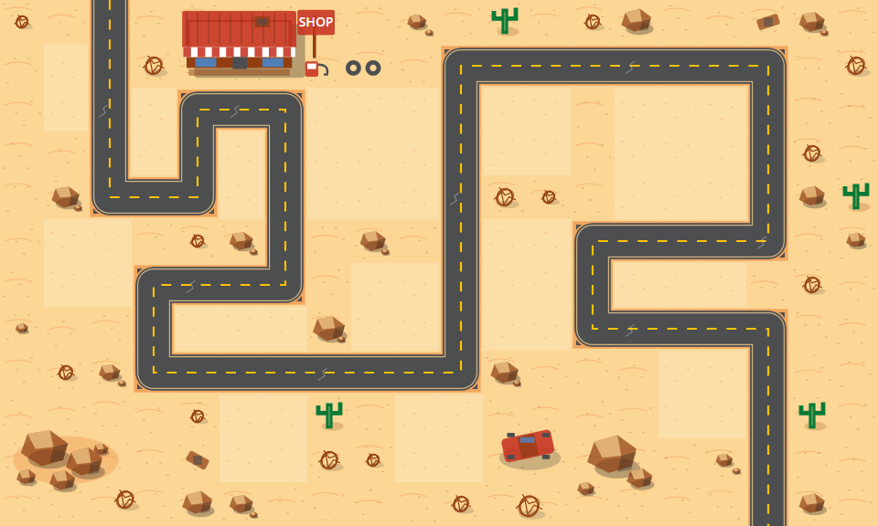

# KARZ TD — Desert highway map starter

The approved 20 × 12 layout uses 48px tiles (960 × 576px). There are 59 ordered path tiles and 60 buildable tiles. Tower centers remain free to move within buildable areas; placement checks the entire circular footprint and existing towers.

## Run the preview on Windows

Map layout and design: **Reagan Moore**.



After completing setup below, double-click **Launch KARZ.cmd** to start the preview.

Install Python 3.12, then open a new PowerShell window in the repository folder:

```powershell
py -3.12 -m venv .venv
.\.venv\Scripts\python.exe -m pip install -r requirements.txt
.\.venv\Scripts\python.exe preview.py
```

Click to place a test tower; press B to show buildable zones, Z to remove the latest tower, and Esc to exit. The moving red marker demonstrates the ordered enemy route. This is a map integration preview, without combat, waves, or economy.

## Open in Tiled

Open `maps/desert_highway.tmx`. The layers are:

- **Artwork:** the polished map image, locked to prevent accidental movement.
- **Tile roles:** hidden by default; enable to paint semantic path/buildable tiles with the included role tileset.
- **Buildable zones:** rectangles matching the original buildable tiles, for inspection.
- **Enemy route:** the ordered polyline through cell centers.
- **Entrance and exit:** named point objects.

The Python loader reads Tile roles for placement and Enemy route for movement. After editing roles in Tiled, update the route polyline as needed. Buildable zone rectangles are reference overlays, not the runtime authority. The JSON is an original-layout snapshot; it is not updated automatically by Tiled. `export_map.py` regenerates the original logic layers and overwrites the TMX/JSON, so do not run it over manual edits you wish to keep.

The artwork is a flattened background. Tiled logic edits do not redraw the road or decorations; revise the background separately if the layout changes. The map's decorative objects are baked into the artwork, not individual movable sprites yet.

## Integrate into the game

After creating the Pygame display, call `load_map(path)` from `map_runtime.py`. Blit `game_map.artwork`, move enemies through `game_map.waypoints`, and call `game_map.can_place(x, y, radius, towers)` before placing a tower. Existing towers use `(x, y, radius)` tuples. `preview.py` shows those calls together.

## Verify

```powershell
.\.venv\Scripts\python.exe -m unittest discover -s . -p test_map.py
.\.venv\Scripts\python.exe preview.py --smoke
```

Format references: [Tiled TMX documentation](https://doc.mapeditor.org/en/stable/reference/tmx-map-format/) and [pytmx usage](https://github.com/bitcraft/pytmx/blob/master/readme.md).
