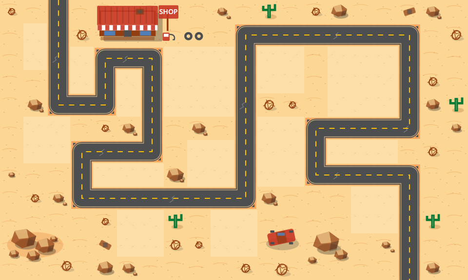

# KARZ TD — Desert highway map starter

## Maps and progression

- **Desert Highway** is the Easy map and clears after wave 5.
- **Canyon Crossing** is the Medium map and clears after wave 7. It has 49 route tiles and 38 buildable tiles.
- **Razorback Pass** is the Hard map and clears after wave 10. Its 31 build tiles are shaped by
  21 sight-blocking ridge tiles and a two-tile untargetable tunnel.
  KARZ disappear while their centers are inside the connected tunnel and reappear at the exit;
  they continue moving underground. Ridge tiles block tower targeting across them.
- **Caldera's Edge** is the final Extreme map, displayed and stored under the existing **Impossible**
  difficulty identifier for account compatibility. Two separate 26-cell routes alternate spawns from
  the existing shared wave budget. There are 30 build tiles, 16 sight blockers and two connected
  two-cell tunnels; enemies disappear and cannot be targeted inside either tunnel.
  Lava, sulfur, smoke and flames are static decoration, not extra obstacles or damage sources.
  The approved artwork is shared by the selection thumbnail and gameplay.
  This addition does not change money, prices, refunds, enemy statistics or wave counts; balance
  tuning is deferred. The clear target remains wave 10. Old Impossible placeholder checkpoints
  start a fresh run; new Caldera checkpoints carry a map identifier.

`export_caldera_map.py` reproduces the approved editor grid and both TMX paths. It does not
regenerate artwork. Pale ash ground marks build areas; **B** shows exact tile-based placement
boundaries where decorative edges are softened. Fire animation is not included in this pass.

**Draft art-alignment caveat:** the approved generated image is not yet pixel-aligned with all
semantic tiles. The placement overlay exposes overlaps with scenic rocks and the lower-right
road edge. Preserve the approved grid and correct the artwork before treating this map as
release-ready; gameplay tests validate logic, not image alignment. Balance is also unvalidated.

The selected map supplies its artwork, route, build zones, difficulty rules, and clear wave automatically.
Sandbox mode continues indefinitely; the same post-clear behavior is intended for a future Freeplay option.

The approved 20 × 12 layout uses 48px tiles (960 × 576px). There are 59 ordered path tiles and 60 buildable tiles. Tower centers remain free to move within buildable areas; placement checks the entire circular footprint and existing towers.

## Run the full game on Windows

After installing dependencies as shown below, run `.\.venv\Scripts\python.exe main.py`.
Sign in, open the difficulty selector, and choose **Hard — Razorback Pass** for the approved
volcanic map. The card preview and playable map use the same artwork. Beat Medium to unlock
Hard, or use an existing admin account to test every map. Hard sandbox is also available
once unlocked. `Launch KARZ.cmd` and `preview.py` launch the older Easy-map preview, not this UI.

## Run the legacy preview on Windows

Map layout and design: **Reagan Moore**.



After completing setup below, double-click **Launch KARZ.cmd** to start the preview.

Install Python 3.12, then open a new PowerShell window in the repository folder:

```powershell
py -3.12 -m venv .venv
.\.venv\Scripts\python.exe -m pip install -r requirements.txt
.\.venv\Scripts\python.exe preview.py
```

Click a green spot to place a base tower. Click a tower to select it and see its range, then press **Upgrade (free)** or U to upgrade it (3 levels). Right-click deselects, B shows buildable zones, Z removes the latest tower, and Esc exits. Placeholder enemies spawn continuously along the route; towers target the enemy furthest along the path within range. The bottom bar shows towers, kills, and enemies that leaked. There is no economy yet: upgrades are free and enemy stats are placeholders.

On macOS, use `python3 -m venv .venv`, then `.venv/bin/python` in place of `.\.venv\Scripts\python.exe` in the commands above and below.

## In-game controls

| Key / button | Action |
| --- | --- |
| Click | Place a tower, or select one |
| U / Upgrade | Upgrade the selected tower |
| Z | Undo the latest tower |
| Space or P / pause button | Pause and resume (you can still place and upgrade towers while paused) |
| F / speed button | Cycle game speed 1x → 2x → 3x |
| N | Start the next wave now (sandbox only) |
| B | Show buildable zones |
| Right-click | Deselect |
| Esc | Back to the menu |

Between waves, the top banner previews the next wave (enemy count and HP). During a wave, the chip in the top-right corner shows what is coming next. Speed-ups run the simulation in extra steps, so the in-game timer counts game time and the time leaderboard stays fair.

## Achievements

Open **Achievements** from the home screen to see all eight, which ones you have, and when you unlocked them.
They unlock during regular games only (sandbox towers are free, so tower and gold goals would not mean anything there):

| Achievement | Goal |
| --- | --- |
| First Victory | Win your first game |
| Untouchable | Clear every wave on a map without losing a life |
| Razorback Conqueror | Beat a Hard map |
| Survivor | Clear 5 waves in one game |
| Builder | Have 10 towers on the map at once |
| Fully Loaded | Upgrade a tower to its max level |
| Gold Rush | Earn $400 from kills in one game |
| Big Spender | Spend $500 in one game (refunds don't count) |

A pop-up appears in the top-left corner the moment one unlocks, and it is saved to your account right away.
Achievements unlocked while the server is down are queued with your scores and uploaded later.
Goals are placeholders in `achievements.py`; ids are stored in the database, so change goals freely but never rename an id.

Towers also look different at each upgrade level: a basic turret, a twin-barrel turret, then a gold heavy cannon.

## Online accounts (FastAPI server)

**Quickest way on Windows:** double-click **Play KARZ Online.cmd**. The first time, it creates `.venv` and installs everything. After that it opens the server window and the game together, already connected. Close the server window to stop the server.

If Windows Smart App Control is on, it blocks SQLAlchemy's compiled files and the server would crash with *An Application Control policy has blocked this file*. The launcher detects this and installs SQLAlchemy's plain-Python version automatically. To fix it by hand, run `.\.venv\Scripts\python.exe -m pip install --force-reinstall --no-deps <the sqlalchemy-2.1.6-py3-none-any.whl link from the launcher>`.

**Saving progress:** the game saves a checkpoint (wave, lives, money, kills, time and every tower) after each cleared wave, and again if you leave between waves. Next time you press Play or Sandbox on that level, it asks whether to continue from the next wave or start a new game. Leaving in the middle of a wave means you replay that wave. Winning or losing removes the checkpoint. Regular and sandbox games are saved separately.

**Sandbox leaderboards:** sandbox games are saved when you leave after clearing at least one wave. They have their own boards (Most waves, Top score) under the Sandbox switch on the leaderboard screen, and never unlock levels or count toward an account's best score.

**Scores while offline:** if the server goes down mid-game, the finished score (and any checkpoint) is saved on your computer (`~/.karz_td/pending_runs.json`) and uploaded automatically the next time you log in, open the level select, or finish another game. Scores the server refuses (for example a level that is locked for that account) are dropped instead of retried forever.

By default the game saves accounts and scores to a SQLite file on your own computer (`local_backend.py`). To share accounts and leaderboards between players and devices, run the server in `server/` and point the game at it. Both use the same `Backend` interface in `backend.py`, so the screens work the same either way.

Install the server requirements (this also installs the game requirements):

```powershell
.\.venv\Scripts\python.exe -m pip install -r server\requirements.txt
```

Start the server locally (it creates `karz_server.db` in the repository folder):

```powershell
.\.venv\Scripts\python.exe -m uvicorn server.app:create_app --factory --port 8000
```

Then, in a second window, start the game against it:

```powershell
.\.venv\Scripts\python.exe main.py --server http://127.0.0.1:8000
```

You can set the `KARZ_SERVER_URL` environment variable instead of passing `--server`. With neither set, or with `--offline`, the game saves locally like before. If the server can't be reached, the game shows a message instead of crashing.

Interactive API docs are at http://127.0.0.1:8000/docs while the server is running.

To make an account an admin on the server database:

```powershell
.\.venv\Scripts\python.exe -m server.make_admin you@example.com
```

### Hosting

Set `DATABASE_URL` to the hosted PostgreSQL connection string (Render and Railway both provide one; `postgres://` URLs are converted automatically). Use this start command:

```
uvicorn server.app:create_app --factory --host 0.0.0.0 --port $PORT
```

Players then launch with `--server https://your-app-url`.

### Database changes (migrations)

The server builds and updates its database with [Alembic](https://alembic.sqlalchemy.org/) migrations in `server/migrations/versions/`. Every time the server starts, it applies any migrations the database doesn't have yet, so existing accounts and scores are kept. Databases created before migrations existed are recognized and upgraded automatically.

To change the database: edit the models in `server/sql_backend.py`, then generate a migration and commit it with your change:

```powershell
.\.venv\Scripts\python.exe -c "from alembic import command; from server.migrate import alembic_config; command.revision(alembic_config(), message='describe the change', autogenerate=True)"
```

Read the generated file before committing. `test_migrations.py` fails if the models and the migrations ever disagree.

### API

| Method | Path | Auth | Purpose |
| --- | --- | --- | --- |
| GET | `/health` | none | Server is up |
| POST | `/auth/signup` | none | Create account, returns token |
| POST | `/auth/login` | none | Log in, returns token |
| POST | `/auth/logout` | token | Revoke the token |
| GET / PUT | `/me` | token | Read or update your account |
| GET | `/me/unlocked` | token | Difficulties you can play |
| POST | `/me/runs` | token | Save a finished game, returns new unlocks |
| GET | `/leaderboard/{score,time,lives,waves}` | none | Top players, optional `?difficulty=` and `?mode=regular\|sandbox` |
| GET | `/admin/accounts` | admin token | All accounts |
| PUT | `/admin/accounts/{id}/role` | admin token | Change a role |
| GET / PUT / DELETE | `/me/checkpoints/{difficulty}/{regular\|sandbox}` | token | Read, save or remove the game saved after the last cleared wave |

Passwords are hashed with PBKDF2 and a per-account salt. Tokens are random, stored only as SHA-256 hashes, and expire after 30 days. Roles are always checked against the database, never trusted from the client.

## Open in Tiled

Open `maps/desert_highway.tmx`. The layers are:

- **Artwork:** the polished map image, locked to prevent accidental movement.
- **Tile roles:** hidden by default; enable to paint semantic path/buildable tiles with the included role tileset.
- **Buildable zones:** rectangles matching the original buildable tiles, for inspection.
- **Enemy route:** the ordered polyline through cell centers.
- **Entrance and exit:** named point objects.

The Python loader reads Tile roles for placement and Enemy route for movement. After editing roles in Tiled, update the route polyline as needed. Buildable zone rectangles are reference overlays, not the runtime authority. The JSON is an original-layout snapshot; it is not updated automatically by Tiled. `export_map.py` regenerates the original logic layers and overwrites the TMX/JSON, so do not run it over manual edits you wish to keep.

The artwork is a flattened background. Tiled logic edits do not redraw the road or decorations; revise the background separately if the layout changes. The map's decorative objects are baked into the artwork, not individual movable sprites yet.

## Integrate into the game

After creating the Pygame display, call `load_map(path)` from `map_runtime.py`. Blit `game_map.artwork`, move enemies through `game_map.waypoints`, and call `game_map.can_place(x, y, radius, towers)` before placing a tower. Existing towers use `(x, y, radius)` tuples. `preview.py` shows those calls together.

## Verify

```powershell
.\.venv\Scripts\python.exe -m unittest discover -s . -p "test_*.py"
.\.venv\Scripts\python.exe main.py --smoke
```

Every push and pull request runs the full suite automatically on GitHub (`.github/workflows/tests.yml`, Python 3.12 with a PostgreSQL service), so the PostgreSQL tests run there too. To run every test yourself (needs `server\requirements.txt` installed): `test_server.py` runs the same account, role, unlock and leaderboard tests from `test_backend.py` against the FastAPI server, so both backends must behave identically:

```powershell
.\.venv\Scripts\python.exe -m unittest discover -s . -p "test_*.py"
```

To also run the server tests against a real PostgreSQL database, set `KARZ_TEST_POSTGRES_URL` (for example `postgresql://user@127.0.0.1:5432/karz_test`) first. Those tests wipe that database, so use a throwaway one.

Format references: [Tiled TMX documentation](https://doc.mapeditor.org/en/stable/reference/tmx-map-format/) and [pytmx usage](https://github.com/bitcraft/pytmx/blob/master/readme.md).
